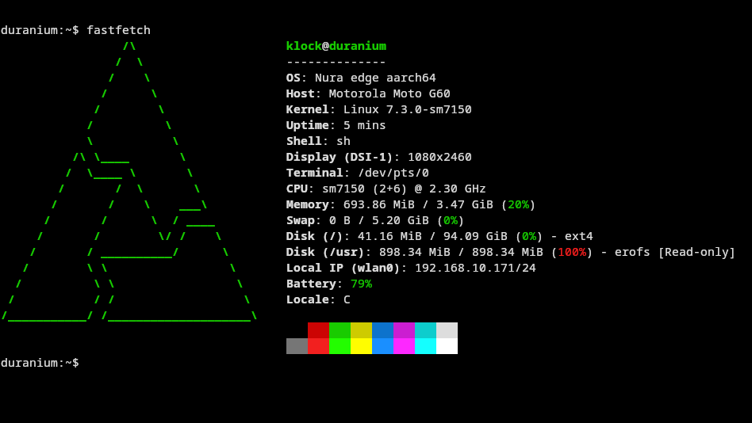

# postmarketOS on the Moto G60 (hanoip)

Work-in-progress port of postmarketOS to the **Motorola Moto G60** (`hanoip`, XT2135-1, Snapdragon 732G / SM7150), aiming to run it as a headless server.

> **Warning:** this flashes `boot`, `vendor_boot` and `userdata` on a device with an unlocked bootloader, and **erases the phone**. Back it up first (step 2). Only slot `b` was tested. Nothing here is risk-free.

## Status

| Area | State |
| --- | --- |
| Downstream kernel (4.14, cool585 Cybertron) | **Works.** postmarketOS edge boots on its own with openrc, SSH over the USB network gadget, a 104 GB root on `userdata` and an nftables firewall |
| Wi-Fi (WCN3990) | **Works (2026-10-30).** 2.4 and 5 GHz, WPA3 (SAE) through NetworkManager, back by itself after a reboot. It needed `CONFIG_MMI_INFO` (the modem crashed without the SMEM item that driver creates). The modem userspace ships in the `device-motorola-hanoip-modem` subpackage: see [`userspace/modem/README.md`](userspace/modem/README.md) |
| Mainline kernel | **Boots from slot a through U-Boot with no PC (2026-11-08), not the server yet.** Linux 7.3 with this project's patches (`kernel/mainline`). Our U-Boot in `boot_a` reads the kernel from UFS and boots a root in super's free region: Wi-Fi through the modem, Tailscale, nftables, a 75-80 % charge limit. Slot a marks itself successful after a complete boot, so both slots work; slot b, the 4.14 above, is active again and stays the server until its services move ([`docs/STATUS.md`](docs/STATUS.md), section 5, and [`docs/MAINLINE.md`](docs/MAINLINE.md), sections 7 to 7d) |

The phone is reachable over Wi-Fi, the USB cable (network gadget) or a USB Ethernet adapter (RTL8152, ASIX, CDC). With a hub the phone is USB host: the PC on the hub cannot reach it over USB, so use Wi-Fi then.

## Tutorial: reproduce the working image

Everything is scripted. Steps marked **[manual]** need your hands on the phone or an interactive prompt. The scripts that change something (`setup-pmaports`, `configure-pmbootstrap`, `build-image`, `setup-usb-net`, `flash-rootfs`, `flash-boot`, `flash-boot-ssh`, `setup-console`, `push-firmware`, `reboot-bootloader`, `mount-vendor`, `update-apkbuild-sums`, `restore-cycle-counts`, `backup-server`, `restore-server`) accept `DRY_RUN=1` (print the commands, change nothing), and `ASSUME_YES=1` skips their questions.

### What you need

| | |
| --- | --- |
| Phone | Moto G60 `hanoip` (XT2135-1) with an **unlocked bootloader** (Motorola's unlock procedure erases it) |
| On the phone | Root `adb` for the backup (KernelSU or Magisk), and a **recovery with adb that can write `userdata`**. The author's phone ran **LineageOS 22.1** and used its recovery, so install that first. Motorola's fastboot refuses to flash `userdata`, which is why a recovery is needed |
| Host | x86-64 Linux, internet, a USB cable, about 11 GB of free disk (4.5 GB kernel tree + 6 GB pmbootstrap), `sudo`. 16 threads recommended |
| Host tools | adb, fastboot, mkbootimg (android-tools), clang, lld, llvm, make, bc, bison, flex, dtc, openssl headers, pv, kpartx, losetup (util-linux), openssl, ps, chroot (what pmbootstrap needs; on Debian and Ubuntu kpartx is in `multipath-tools`), python3 (host scripts and the fake Telegram of `scripts/test-bot`), rustc (for `scripts/test-qgd` and `scripts/test-bot`), curl, NetworkManager (optional). `scripts/check-host` lists what is missing |
| pmbootstrap | 3.12.1 (Python 3.11 or newer: on 3.10 it fails on a missing `tomli`), from its git tag, because PyPI stops at 2.1.0: `git clone --depth 1 --branch 3.12.1 https://gitlab.postmarketos.org/postmarketOS/pmbootstrap.git ~/.local/src/pmbootstrap && python3 -m venv ~/.local/share/pmbs-venv && ~/.local/share/pmbs-venv/bin/pip install ~/.local/src/pmbootstrap`. `scripts/check-host` checks the version against `pmaports/PMBOOTSTRAP_VERSION` |

### 1. Get the repo and configure

```sh
git clone https://github.com/klockmt/hanoip-pmos.git hanoip && cd hanoip
cp .env.example .env      # [manual] set HANOIP_USER (the login name you will use) and adjust paths if you like
scripts/check-host
```

`.env` holds your user name and local paths. It is not in git. Scripts read it; variables already set in your shell win over it.

### 2. Back up the phone

Phone booted in Android, USB debugging on, root granted to adb:

```sh
scripts/backup-partitions
```

Saves `boot`, `vendor_boot`, `dtbo`, `vbmeta`, `persist`, `modemst`, `fsg`, `misc` and `abl` of both slots, plus `SHA256SUMS`, into `$HANOIP_BACKUP_DIR`. It only reads, refuses to run on anything but a hanoip and never overwrites an existing backup. **Keep these files and never publish them** (they hold your serial, MACs and IMEI). You will need `vendor_boot_b` to get back into the recovery.

### 3. Build the kernel

```sh
scripts/build-kernel
```

Downloads cool585's kernel at the pinned commit, applies the patches in [`kernel/downstream-patches/`](kernel/downstream-patches), uses the config from [`pmaports/`](pmaports/device/downstream/linux-motorola-hanoip) and builds `Image.gz` with clang. About 5 minutes on 16 threads, including the 200 MB download.

### 4. Prepare pmbootstrap

```sh
scripts/setup-pmaports            # official pmaports at the pinned commit + our two packages
scripts/pmb init                  # [manual, once] pmbootstrap with the paths from .env; answers below
scripts/configure-pmbootstrap     # device, downstream kernel, openrc, SSH key, user
```

In `init`, pick device `motorola-hanoip`, the same user name as `HANOIP_USER`, and a console-only setup (no graphical UI). The other questions are yours. `configure-pmbootstrap` then forces the settings this port depends on (the downstream kernel, openrc because 4.14 cannot run systemd, and the SSH key) and creates a dedicated passwordless SSH key at `$HANOIP_SSH_KEY` if you have none.

### 5. Build the image

```sh
scripts/build-image
```

Packages the kernel from step 3, builds the device package and runs `pmbootstrap install`. It asks for your `sudo` password and for the password of the phone user **[manual]**. Result in `$PMB_WORK`: the rootfs (~2 GB; pmOS grows it to fill `userdata` on first boot), `boot.img` (only the kernel) and `vendor_boot.img` (initramfs, cmdline and DTB).

### 6. Flash

**6a. The rootfs, through the recovery.**

1. **[manual]** Boot the LineageOS recovery. From Android: `adb reboot recovery`. If you already flashed pmOS before, restore the recovery first: `fastboot flash vendor_boot_b "$HANOIP_BACKUP_DIR/vendor_boot_b.img"` and `fastboot reboot recovery`. Do not zero or replace `dtbo`: that recovery needs it.
2. **[manual]** In the recovery menu: *Advanced → Enable ADB*. `adb devices` must list the phone.
3. Run:

```sh
scripts/flash-rootfs
```

It checks the phone is a hanoip, asks before erasing, writes the image to `userdata`, then reads it back and compares SHA-256.

**6b. vendor_boot and boot, with a test first.**

```sh
adb reboot bootloader            # or hold Volume Down while powering on
scripts/flash-boot
```

It flashes `vendor_boot_b`, then does a **temporary** `fastboot boot` of the new `boot.img` and waits for SSH (it sets up the PC's USB network by itself once the interface appears). Only if SSH answers does it reboot to the bootloader (the phone's `sudo` asks for the user password **[manual]**), flash `boot_b` and reboot. If SSH never comes up, `boot_b` is left untouched.

### 7. Use it

```sh
scripts/hanoip-ssh                # log in as HANOIP_USER at 172.16.42.1
scripts/hanoip-ssh 'uname -r'
```

The PC address is `172.16.42.2/24` on the phone's USB interface (`scripts/setup-usb-net` recreates it; it is a NetworkManager connection named `hanoip-usb`).

On the phone, `hanoip-status` (and Telegram `/status`) prints the health of the phone in ten lines, and `hanoip-status -h` says what each is and where it is read. `hanoip-charge-limit` holds the battery near 80 % with the cable feeding the phone (bypass), `hanoip-thermal` pauses charging and caps the CPU when the battery heats up, and both are on by default. The services, what each does and how to check it are in [`docs/HOMELAB.md`](docs/HOMELAB.md); what was measured about the battery is in [`docs/BATTERY.md`](docs/BATTERY.md). Check the decisions without hardware with `scripts/test-charge-limit` and `scripts/test-thermal`.

### 8. Update only the kernel later

```sh
scripts/build-kernel
scripts/mkbootimg-kernel                 # boot.img with only the kernel
scripts/reboot-bootloader
fastboot boot boot.img                   # temporary test, nothing flashed
fastboot flash boot_b boot.img           # if it came up fine
```

`vendor_boot` only changes when you change the initramfs, the cmdline or the DTB (then re-run `scripts/build-image` and `scripts/flash-boot`).

### Going back

Restore from your backups: `fastboot flash boot_b "$HANOIP_BACKUP_DIR/boot_b.img"`, same for `vendor_boot_b`, then reflash or restore Android as usual. Do not write the `misc` backup back as it is (it can send the phone to the bootloader once); zeroing it is safer.

## What was verified, and how

I want to be clear about what has and has not been run end to end.

| Step | How it was checked |
| --- | --- |
| `check-host` | Ran on the author's machine |
| `build-kernel` | **Ran from scratch** in an empty directory from the official download: the 3 patches that existed then applied (there are 10 now), the kernel built (4 min 19 s) and the result **booted pmOS to SSH** with `fastboot boot` |
| `setup-pmaports` | **Ran for real**; the checkout it builds is byte-identical to the author's pmaports that produced the working image |
| `mkbootimg-kernel`, `reboot-bootloader`, `hanoip-ssh` | Used on the real phone in that boot test |
| `build-image`, `configure-pmbootstrap` | Dry-run only (they need `sudo` and an interactive `init`). The commands are the ones the author ran to produce the images that boot. The package build **without** `--envkernel` (letting pmbootstrap compile the kernel itself) was never tried |
| `backup-partitions`, `flash-rootfs`, `flash-boot` | Tested against a simulated phone, including the refusals (wrong device, not in recovery, corrupted write, no SSH). The underlying `dd`, `adb` and `fastboot` commands are the ones used on the real phone |
| `setup-usb-net` | Interface detection and the `nmcli` command checked; same command the author used |
| `build-mainline-kernel`, `mainline-ram-image`, `mainline-make-root`, `build-mainline-uboot`, `mainline-boot-a-image` | Run on the author's machine and phone (2026-11-07 and 08): what they build booted on the phone, and `mainline-make-root` left super unchanged outside its region (`docs/MAINLINE.md`, sections 7 to 7d). The U-Boot built on 2026-11-11 (Duranium first from either slot) is written to `boot_b` and has **not booted yet**. Not run on a clean machine |
| `backup-server` | Run on the author's phone on 2026-11-08 (1.7 GB over the tailnet at 1 MB/s): hashes equal on both sides, one file restored and compared, the phone's copy removed. Resuming a dropped copy and refusing a damaged one were tested only against a simulated phone (`scripts/test-backup-server`) |
| `restore-server` | Run on the author's phone on 2026-11-10, in a session that left no record of its output: on 2026-11-11 the restored data, the sudo password and `harden` (root login refused) were all found in place. Its step that sets the owner of Syncthing's folder ran while the NAS disk was away and had to be repeated by hand. It puts the 4.14 server's data (Wi-Fi profiles, Tailscale state, AdGuard Home, Samba, Syncthing, the bot's secrets) back on a fresh Duranium, sets the login user's sudo password and, last, turns root login off. Tested only against a simulated phone (`scripts/test-restore-server`: what is sent and what is not, owners and modes kept, no secret in any output, `harden` refusing without sudo) |
| `duranium-image` | Run on the author's machine on 2026-11-11 (three times, device package r50 to r52): the image it built was checked with `dump.erofs`, delivered to the phone as an A/B update and is the running system (`docs/DURANIUM.md`). Pass `--image-version=YYMMDDNN` for an update, or the image keeps the old version. Not run on a clean machine |
| A completely fresh machine, start to finish | **Run to the image (2026-11-02), in a clean KVM virtual machine** (Ubuntu 24.04 cloud image, only apt packages and the README steps, from the `beta` branch): `check-host`, `setup-pmaports`, `build-kernel`, `pmb init`, `configure-pmbootstrap` and `build-image` all ran and produced `boot.img` (header v3), `vendor_boot.img` (command line starting with `console=ttyMSM0,115200n8`) and the 2 GB rootfs. It needed five changes to the README and scripts, all fixed above. **Not run:** the flashing and booting that image on a phone, which erases `userdata`, and a second person following the README. The first attempt in a rootless container stopped at `pmbootstrap init` (no `origin/main`), the second in a privileged one at the partitions (no udev), which is why a VM was used |

## Layout

| Path | What it is |
| --- | --- |
| `pmaports/` | `device-motorola-hanoip` and `linux-motorola-hanoip` packages, and `PMAPORTS_COMMIT`, the official pmaports commit they were built on; `linux-motorola-hanoip-mainline`, the Linux 7.3 package built from kernel.org and copies of `kernel/mainline` (not built yet) |
| `kernel/downstream-patches/` | Patches for the 4.14 kernel (loop partition rescan, `clk.c` for `DEBUG_FS`, `icnss` BDF/REGDB/`host_cap`, console on the screen, splash framebuffer, serial kept out of the `mmi_info` log) |
| `kernel/dts/` | Mainline DTS for the hanoip |
| `userspace/modem/` | Notes on the modem/Wi-Fi userspace for 4.14 (diagnosis history). The files themselves are the `device-motorola-hanoip-modem` subpackage |
| `scripts/` | All the steps above, `check-repo` (self-check to run before every commit: checksums, patch copies, private-data scan, and every `test-*` regression test; none needs the phone), `push-firmware` and `mount-vendor` for the Wi-Fi investigation, and `collect-device` (runs in Termux on the phone) |
| `CONTRIBUTING.md`, `.github/ISSUE_TEMPLATE/` | How to report and how to change (what never goes in an issue, the commit and test rules) and the issue forms |
| `docs/` | What works (`STATUS.md`), what broke and where it is kept from breaking again ([`PITFALLS.md`](docs/PITFALLS.md)), how the phone is run (`HOMELAB.md`), the battery study (`BATTERY.md`), verified device facts and sanitized dumps (`device-info/`) |
| `NOTES.md` | Detailed working notes: pitfalls already solved, boot test results |

## Pitfalls already solved (details in `NOTES.md`)

- The bootloader only runs **Android boot header v3**; the DTB, initramfs and cmdline live in `vendor_boot`, not in `boot`.
- The ramdisk must be **LZ4 legacy**; gzip or zstd leave the phone stuck on the Motorola logo.
- The UFS has **4096-byte sectors**: the rootfs GPT must match, and the 4.14 loop driver needs patch `0001` to see its partitions.
- Large continuous transfers over the USB network gadget bring it down; `scripts/push-firmware` limits itself to 1 MB/s.
- **The A/B slot must be marked successful at every boot** (`qbootctl`, installed by the device package), or after ~7 reboots the bootloader invalidates the slot and switches to the other one. Recover with `fastboot getvar slot-unbootable:b` (check first), `fastboot set_active b`, `fastboot reboot`.
- The bootloader rewrites every `console=` to `console=null`; patch `0004` turns that into the screen console, and `0005` draws it on the bootloader's framebuffer (the MSM fbdev emulation cannot work with this driver).
- The modem firmware needs SMEM item 134 (`mmi_unit_info`), created by `CONFIG_MMI_INFO` (+ `CONFIG_MMI_ANNOTATE`); without it Wi-Fi crashes ~0.7 s after WLFW connects. `scripts/test-kernel-config` checks the options.
- With the charge limiter holding on a cable or PD hub, `usb/online` reads 0 even though the input feeds the phone; check `usb/input_current_now` instead.
- The kernel must not use `CONFIG_EFI_ZBOOT`, and `FW_LOADER_USER_HELPER_FALLBACK` must be off (otherwise every missing firmware file costs 60 s of boot).

## What is not in this repo

Partition backups, the device collection (serial, MAC and IMEI), and the proprietary firmware from `/vendor`. Take them from your own phone with `scripts/backup-partitions` and `scripts/collect-device`.

## License

GPL-2.0-only, see [`LICENSE`](LICENSE) for the text and [`NOTICE`](NOTICE) for the scope. The kernel patches and the device-tree sources are derived from the Linux kernel; the packaging, scripts and documentation use the same license. Proprietary firmware and device identifiers are not part of the repository.

## Duranium running

`fastfetch` on the phone after the first boot of the mainline image: Linux 7.3.0-sm7150 on aarch64, `/usr` on a read-only erofs, the rootfs on `userdata`, Wi-Fi up.


